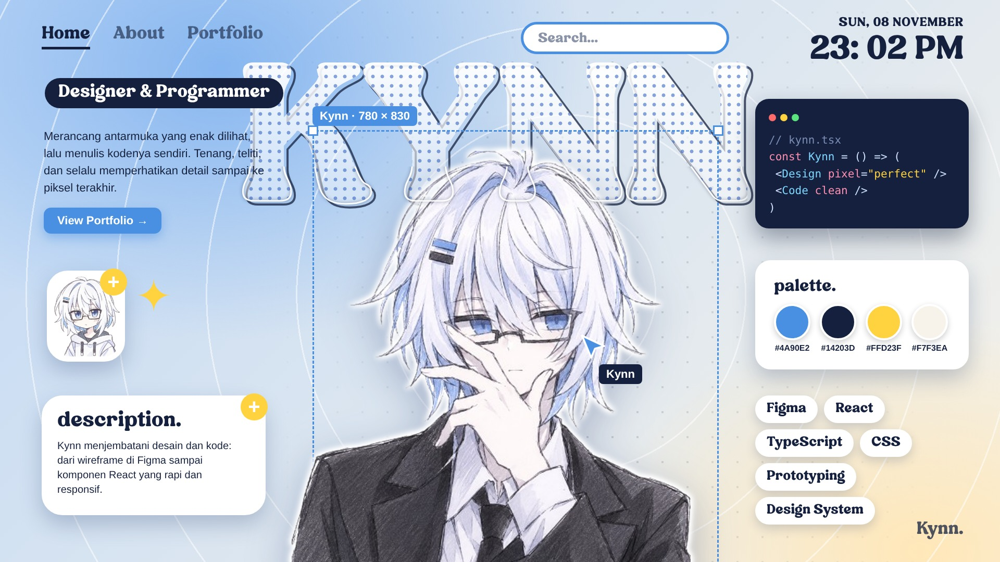

<div align="center">

  <sub>Sleek modern cool music player for android, open source, packed with features and doesn’t collect ur data >_< oh and, still in beta!</sub>
  <br/>
<p align="center">
  <a href="https://github.com/kenza11-star/Vantra/releases">
    
</a>
  <a href="https://github.com/kenza11-star/Vantra/stargazers">
    
  </a>
  <a href="https://github.com/kenza11-star/Vantra/network/members">
    
      <a href="https://github.com/kenza11-star/Vantra/releases">
    
  </a>
  </a>
  <a href="https://github.com/kenza11-star/Vantra/commits">
    
  </a>
  <a href="https://github.com/kenza11-star/Vantra/releases/latest">
    
  </a>
  <a href="https://github.com/kenza11-star/Vantra/issues">
    
  </a>
  <a href="https://github.com/kenza11-star/Vantra/blob/main/LICENSE">
    
  </a>
  <a href="https://github.com/kenza11-star/Vantra/blob/main/Roadmap.md">
    
  </a>

</p>
</div>


> [!WARNING]
> This app still on beta!, expect some bugs! reporting it will be useful too.

---

## Hhhh-how to install? :3

1. On your phone, open the [latest release](https://github.com/kenza11-star/Vantra/releases/latest).
2. Download the `.apk` that matches your phone. If you are not sure, pick **arm64**, that is almost every phone from the last 8 years. The **universal** one works everywhere but is bigger.
3. Open the downloaded file. Android will ask you to allow installs from your browser or file manager, say yes (you can turn it off again after).
4. Open Vantra. You are done, no account needed to start listening.

Updating works the same way: install the new apk over the old one and your library stays.

> [!TIP]
> Only download Vantra from the releases page of this repo. A random mediafire or telegram link could be a modified app, and then your logins would not be safe.

---

## How to build it yourself

You only need this if you want to change the code. If you just want to use the app, use the install steps above.

### What you need
- A Mac, Linux or Windows computer (the script below is for Mac and Linux, on Windows use WSL or Android Studio)
- [Android Studio](https://developer.android.com/studio) (latest stable). It brings JDK 21 and the Android SDK with it
- Android SDK 36 and NDK `27.0.12077973`. Android Studio offers to download both the first time you open the project
- About 10 gb free disk space, the first build downloads a lottt
- A phone with USB debugging on, or an emulator.

### Steps
```bash
git clone https://github.com/kenza11-star/Vantra.git
cd vantra-music
```

1. Open the folder in Android Studio once and let it finish syncing. This also creates `local.properties` with your SDK path.
2. Build and install on your connected phone:
   ```bash
   ./build.sh --debug -i
   ```
   First build takes a while, the next ones are much faster.
3. Or build the apk only and install it by hand. The apk lands in `apk-generated/`:
   ```bash
   ./build.sh --debug
   adb install -r apk-generated/*-debug.apk
   ```

Handy options (see `./build.sh --help` for all of them):

| Command | What it does |
|---|---|
| `./build.sh --debug -i` | debug build, installs and opens it on your phone |
| `./build.sh --release -cc` | release build for arm64 and universal (slow, R8 takes about 5 minutes) |
| `./build.sh -fd --release` | F-Droid flavor, without the self-update permission |
| `./build.sh -k` | stops stuck Gradle builds |

Use **debug** while you are playing around, it builds much faster. A debug build installs next to the real app (`the debug package`), so it will not touch your normal install, but it is also a bit slower to run.

### Optional keys
Vantra builds fine without these, only the matching feature is switched off. Put them in `local.properties` (it is never committed):

```properties
LASTFM_API_KEY=...
LASTFM_SECRET=...
DISCORD_CLIENT_ID=...
```

Never commit your keys. Libre.fm works without any key.

### If the build fails
- `Unresolved reference` or Hilt errors that make no sense: delete the `build/` folders and `.gradle/` and build again.
- Stuck or weird Gradle: `./build.sh -k`, then try again.
- Wrong Java: make sure Gradle uses JDK 21 (Android Studio → Settings → Build Tools → Gradle → Gradle JDK).
- Still stuck? Open an [issue](https://github.com/kenza11-star/Vantra/issues) with the error text.

Want to send a fix? Read [CONTRIBUTING](.github/CONTRIBUTING.md) first.
---
## Wants to help? bug report? report it on issues!

Or read contribute.md there

---
## Disclaimer

Vantra is an independent, unofficial project made for personal and educational use. It is provided as is, without warranty of any kind.

- Vantra is a fully open source project that is created purely for educationa and personal use. thats why, we dont sell this software, or monetize it. we do not have any intent to add commercial values in the future. thanks!
- And were deeply respect the hardwork of artist musicians ajd contwnt creators. without them there is also no vantra: i strongly suggest that you, as user, subscribe to Apple music or youtube premium, to support the creators you listen. I do not intend to hurt creator with this app.
- It is **not affiliated with, endorsed by, or sponsored by** YouTube, YouTube Music, Google, Spotify, Apple, Last.fm, Shazam, Discord or any other service it can connect to. All names, logos and brands belong to their respective owners.
- Vantra does not host, store or distribute any music. Everything is fetched from third-party services when you ask for it, and those services can change or stop working at any time.
- You are responsible for how you use the app, including the terms of service of the accounts and services you connect and the copyright laws where you live.
- Importing from other services (Spotify, etc.) uses your own account. Don't share your login data or tokens with anyone.
- Importing music MAY need your own account with its password. WE'RE NEVER see your password.

# FAQ
## Q
## 1.Is it safe to log in? (read this before signing in)

## A
Tbh, you never have to log in to use this thing btw. Search, play, lyrics and downloads work without an account. Signing in is only for syncing your YouTube Music library, importing playlists from Spotify / Apple Music / Tidal, and Discord status

**How the sign-in works**
- Vantra opens the real login page of the service (for example accounts.google.com or open.spotify.com) inside the app. You type your password into **their** page, not into a Vantra form.
- After you log in, the app keeps the session token or cookie that the service gives out, so you stay signed in. Your password is not what gets saved.
- That session stays on your phone, in the app's private storage. Vantra has no account system of its own and does not run a server that collects logins.
- The tokens are meant to be used only to talk to the service you signed in to (for example Spotify's own site to read your playlists).
- The app is open source under GPL-3.0 so you do not have to take my word for it, you can always read exactly what it does with them :)

## Q
## 2. Pls add liquid glass

## A
No, and not now. maybe in form of modules created by someone in the future

## Q
## 3. Monochrome/flac stream doesnt work

## A
The server down, its on their side not us. use other anvailable sources

---

## These incredible project helped vantra a lot! check them out too :3

- **ViviMusic** by [vivizzz007Z](https://github.com/vivizzz007Z) )[Their repo](https://github.com/vivizzz007/vivi-music)) -- For the base app. This app is a fork from this project.
- **Metrolist** by [Mostafa Alagamy](https://github.com/mostafaalagamy) ([Repository](https://github.com/mostafaalagamy/Metrolist)) -- For the base framework.
- **SimpMusic** by [maxrave-dev](https://github.com/maxrave-dev) ([Repository](https://github.com/maxrave-dev/SimpMusic)) -- For the lyrics API provider.
- **Archivetune** by [Rukamori](https://github.com/rukamori) ([Repository](https://github.com/rukamori/ArchiveTune)) -- For design and architectural inspiration.
- **RiMusic / InnerTube** by [fast4x](https://github.com/fast4x) ([Repository](https://github.com/fast4x/RiMusic)) -- For YouTube Music InnerTube API service wrapper.
- **LRCLib** by [tranxuanthang](https://github.com/tranxuanthang) ([Repository](https://github.com/tranxuanthang/lrclib) / [Website](https://lrclib.net/)) -- For synchronized LRC lyrics provider integration.
- **Monochrome Music** by [monochrome-music](https://github.com/monochrome-music) ([Repository](https://github.com/monochrome-music/monochrome) / ([Website](https://monochrome.st)) -- Flac streams, visit their web, very cool one.
- **Auto Eq** ([Web](https://autoeq.app)) -- The equalizer database

---

## Open source APIs vantra talks to!!

These are the open source apis and server we get gets its lyrics, streams and data from. They r free for everyone because of these good people, so go give them a star!

- **LyricsPlus** by [Ibra Al Tabian](https://github.com/ibratabian17) ([repos](https://github.com/ibratabian17/LyricsPlus)) s
- **Better Lyrics API** by [Boidushya](https://github.com/boidushya) ([repos](https://github.com/better-lyrics/api)) 
- **LRCLIB** by [tranxuanthang](https://github.com/tranxuanthang) ([repos](https://github.com/tranxuanthang/lrclib) / [Website](https://lrclib.net/)) 
- **SimpMusic Lyrics** by [maxrave-dev](https://github.com/maxrave-dev) ([repos](https://github.com/maxrave-dev/SimpMusic)) 


<div align="center">
  <sub>star the repo plssss!</sub>
</div>
